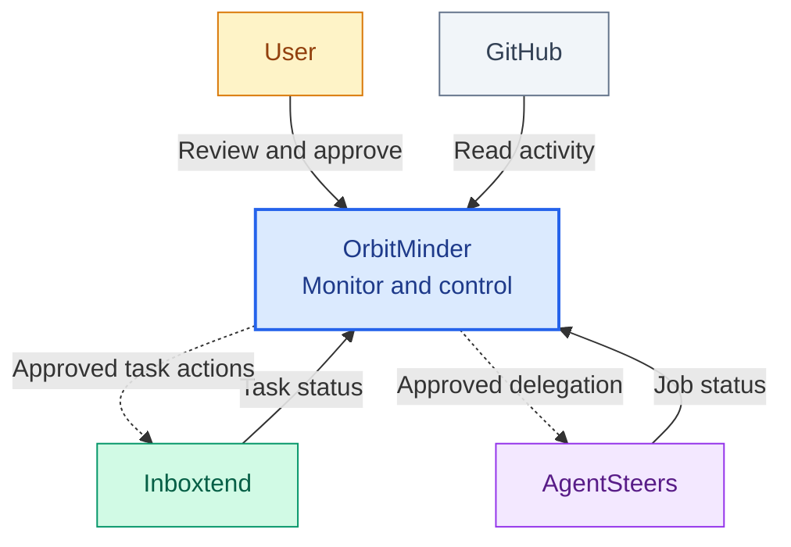
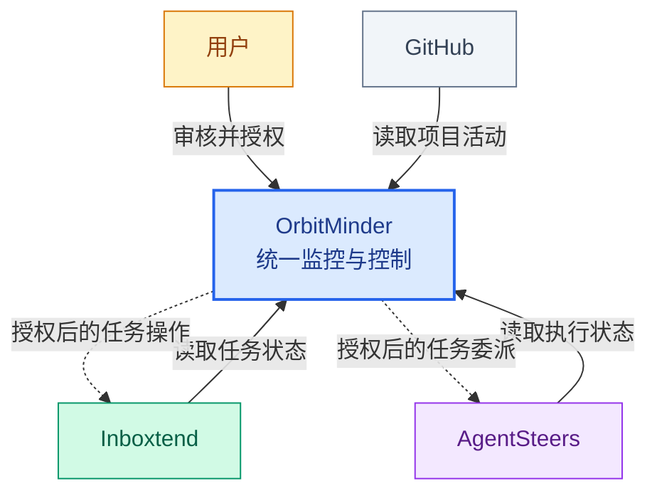

# OrbitMinder

**Your projects. Always in sight.**

**Read in:** [English](#-why) | [中文阅读](#中文说明chinese) · [中文项目简介](#-项目简介与当前状态) · [中文开发规则](#️-开发流程与仓库规则中英文同步)


OrbitMinder is an open-source, personal AI project command center. Its goal is to consolidate projects, follow-ups, deadlines and delegated agent work into one daily view.

**Status (2026-11-19):** early, read-only prototype. The Python CLI supports local example JSON and GitHub repository/activity summaries. A Next.js website, Google sign-in code, a protected single-owner GitHub brief API, and an on-demand private dashboard are implemented in source, but production deployment, live Google OAuth and end-to-end behavior are **not verified**. Gmail OAuth connection, Calendar, full cross-source sync and real agent execution are not integrated; a read-only Gmail metadata adapter exists in source. GitHub activity is sampled; it does not prove task completion.

## Three-product architecture (decision 2026-11-21)

### 🧭 Architecture diagram

> **Target design: bidirectional monitoring and control.** Solid arrows are read-only data flows. Dashed arrows are **future, explicitly approved commands**, not implemented live integrations.



**One authoritative executor per action:** Inboxtend retains ownership of email tasks and its existing Agent runs; AgentSteers executes only separately authorized work. Future write requests require server-side permission checks, task revision checks, an idempotency key, audit history, and failure reconciliation. GitHub access remains read-only unless separately scoped and authorized. **This is a product goal, not a claim that write APIs or real Agent execution are already available.**

**Integration order:** first ship a minimal authenticated read-only Inboxtend task feed, then the unified status dashboard, then an approval-gated control API. Do not duplicate Gmail syncing or execution. The current Inboxtend–AgentSteers bridge is mock-only.

Additional technical details and milestones are documented in `docs/architecture.md`.

## 🎯 Why

Your projects may live across GitHub, Gmail, calendar, personal planning and multiple AI agents. OrbitMinder is intended to answer:

1. What changed since yesterday?
2. What are my three best next actions?
3. What is waiting, blocked, or due soon?

## 🚀 Quick start

Requires Python 3.10+; no external dependencies.

```bash
python3 -m orbitminder.cli --data examples/projects.json
```

The command above uses deterministic sample data, **not** a live sync.

### GitHub live repository inventory (read-only)

```bash
# Public repositories, no credentials required
python3 -m orbitminder.cli --github-owner scyllarusllc

# Optional: include accessible private repositories with a least-privilege token
# Export GITHUB_TOKEN privately in your shell; never commit it or paste it into logs.
python3 -m orbitminder.cli --github-owner scyllarusllc --github-limit 100

# Activity-aware brief: last 7 days of commits and currently open PRs/issues
python3 -m orbitminder.cli --github-owner scyllarusllc --github-activity --github-limit 20 --activity-max-repos 10 --activity-days 7

```

The GitHub inventory reads repository metadata only (name, URL, archived state, last push, visibility and fetch timestamp). The current daily brief includes those repositories as active project records with a generic review action. Without --github-activity it does **not** fetch pull requests/issues or infer actual task priority. With --github-activity, it makes up to three additional read-only GitHub API requests per checked repository (commits, open PRs, open issues); it excludes PRs from the issue count, sorts checked project recommendations by simple open-item heuristics, and never claims work is complete. This is a triage heuristic, not AI analysis. To limit API use, activity checking defaults to the first 10 nonarchived repositories out of the first 30 returned repositories; other repositories are not activity-verified. Counts are lower bounds if a query returns 100 items, since pagination of activity is not implemented. An HTTP/API error stops the command rather than returning a misleading empty inventory. Without GITHUB_TOKEN, only public repos are included. With it, only repositories owned by the selected account and accessible to that token are included. The token is read from the environment and not persisted.
 The existing ChatGPT "Mission Control" daily automation is separate and remains unchanged.

## 📋 Development progress and next tasks

Updated **2026-11-19** from the `main` branch. **Current focus:** OM-006–009 storage/freshness/dashboard read path in source; OM-011 Gmail metadata adapter and independent PKCE OAuth connection UI in source. Live consent and end-to-end Gmail sync are still pending. Live data import and production deployment remain pending; automated test suites were removed at the owner's request. This checklist reports **source-code implementation**, not production readiness. A checked box is not a claim of successful deployment or live integration. Work in the order below; keep the read-only, self-hostable MVP as the default.

### Completed in source

- [x] **OM-001 — CLI project brief:** deterministic local project input, ranked next actions, waiting/blocked/due summaries and JSON output.
- [x] **OM-002 — Read-only GitHub inventory:** repository metadata and sampled recent commits, open PRs and issues, with source URLs.
- [x] **OM-003 — Web foundation:** Next.js homepage, Google sign-in integration code, protected dashboard shell and owner allowlist checks.
- [x] **OM-004 — On-demand GitHub dashboard:** authenticated API backed by the Python CLI and a manual refresh UI.
- [x] **OM-005 — Dashboard activity sections:** display sampled GitHub counts, next actions, waiting/blocked/due lists and unverified sources (`a1bc347`). No live deployment claim.

**2026-11-21 prototype update:** Added `orbitminder/inboxtend_contract.py` with strict SQLModel/Pydantic validation for the versioned Inboxtend task-summary feed (metadata only; no mail bodies, attachments, credentials, or task execution). Added `pyproject.toml` declaring FastAPI, SQLModel and Typer dependencies. **Contract only:** no live Inboxtend connection, FastAPI route, database migration, or production verification yet. Existing SQLite tables are unchanged.

**2026-11-21 source update:** The Inboxtend v2 SQLite task snapshot model, owner-scoped cached task reader, authenticated Next.js API route, and read-only Dashboard panel have been committed. The panel shows saved task status, priority, dates and Agent labels; it does not fetch live data or dispatch jobs. **No automated tests, live integration, deployment, or runtime verification were performed.** Configure an initialized v2 database and private `INBOXTEND_ACCOUNT_KEY` to populate it.

**2026-11-21 source milestone:** Added `python3 -m orbitminder.sync_inboxtend`, an operator-triggered, authenticated read-only task import using configured HTTPS and owner-scoped credentials. The cached Dashboard panel now includes sync counts and failure state. This is **code committed only**: no runtime tests, live integration, deployment, or background synchronization were performed. See `docs/inboxtend-gateway.md`.

**2026-11-21 UI source update:** The cached Inboxtend task panel now supports title/project search, task-status and Agent-assignment filters, priority/due-date/recent-update sorting, and four status summary counts. All operations are browser-side on the loaded historical snapshot (maximum 100 returned tasks); they do not query the live source or dispatch work. **Code committed, not tested or integrated live.**

**2026-11-21 UI source update:** The Inboxtend cached-task panel now includes expandable read-only task details (review state, executor, Agent job reference, due timezone and snapshot observation time) and a cross-project summary with project filtering (total/open/high-priority counts). These views only operate on up to 100 loaded historical tasks and cannot approve or dispatch an Agent. Source committed directly to main; no tests, integration runs, or deployment were performed.

**2026-11-21 Agent history source update:** Cached task detail can now show owner-scoped stored AgentSteers activity when both the task's executor and external job ID match an independently stored `agent_activities` record. Missing records are explicitly reported; task metadata alone is not proof of actual execution. No Agent actions, tests, live checks, or deployment were performed.

**2026-11-21 Agent overview UI:** The cached Dashboard now groups independently stored AgentSteers job records by project and displays a limited recent-observation list, separating `real` from `mock` records. This is a read-only **per-job state snapshot**, not a full event timeline or proof that referenced jobs executed. Only locally cached tasks and matched same-owner records are displayed. No runtime tests, live integration, or deployment were performed.

**2026-11-21 event timeline source update:** Added an additive v3 SQLite table for append-only AgentSteers job observations, owner-scoped storage/read helpers, and a cached Dashboard timeline distinct from latest job-state snapshots. Only explicitly ingested observations for already-stored jobs can appear. No event-source ingestion pipeline, live verification, automated tests, or deployment has been completed.

**2026-11-21 import-source update:** Added an operator-only `orbitminder.import_agent_events` CLI and an atomic, replay-safe event ingestion method for existing AgentSteers jobs. The input is a reviewed local file, **not** an authenticated live AgentSteers feed. Unknown jobs and conflicting events are rejected; no browser submission, Agent control, automated tests, live integration, or deployment were added. See `docs/inboxtend-gateway.md`.

**2026-11-21 timeline filters:** The Dashboard's persisted AgentSteers event list can now be filtered by selected cached project and execution mode (`real` or `mock`). The interface validates that cached event and activity arrays exist, and shows only up to 15 matching stored events. Filtering is client-side and does not establish a live connection. No automated tests, integration, or deployment were performed.

**2026-11-21 signed event import:** The operator-only AgentSteers event importer now verifies optional owner-bound HMAC-SHA256 envelopes. When `ORBITMINDER_AGENT_EVENT_SIGNING_KEY` is set, invalid, missing, or empty-key signatures fail closed. Signing authenticates a holder of the shared secret, not AgentSteers as the original publisher. Without the key, only manually reviewed unsigned imports remain available. No automated tests, live integration, or deployment verification were performed.

**2026-11-21 status reconciliation source update:** The read-only cached task Dashboard now highlights AgentSteers job references with no corresponding stored job snapshot, and task-reported Agent statuses differing from stored job states. This is a review queue, not proof of failure: timestamps and status vocabularies can differ. The section is limited to loaded cache records. No Agent actions, tests, integrations, or deployment performed.

**2026-11-21 Agent review workflow UI:** The cached-task Dashboard now offers a “Show only review items” toggle, filtering loaded tasks to those with missing stored AgentSteers jobs or differing task-reported and stored job states. Affected task cards display the review reason inline. This is read-only local snapshot comparison, not a verified failure or live sync. No tests, integration, or deployment performed.

### Next milestone — durable, trustworthy project data (P0)

- [ ] **OM-006 — Define normalized models (SOURCE IMPLEMENTED, NOT LIVE-VERIFIED):** owner-scoped SQLite tables for project, source record, sync run, follow-up and agent activity are now in [`migrations/0001_initial.sql`](migrations/0001_initial.sql), with semantics in [`docs/data-model.md`](docs/data-model.md). **Remaining before checking complete:** manually verify migration and owner isolation in an authorized environment; schema is not yet deployed.
- [ ] **OM-007 — SQLite persistence (IMPLEMENTED IN SOURCE, VERIFICATION PENDING):** `orbitminder/storage.py` now creates a private local database and provides owner-scoped project/source upserts, deduplication, and reads. **Remaining:** integrate with the actual backend and manually verify restart and isolation behavior; no live integration claimed.
- [ ] **OM-008 — Freshness tracking (BACKEND SOURCE IMPLEMENTED, UI PENDING):** `ProjectStore.record_sync`, `latest_sync` and `list_source_freshness` retain cached records and report provider `unchecked` / `succeeded` / `partial` / `failed` states separately from source verification. A failed/partial run makes displayed source freshness `stale` and does not erase last success; **Remaining:** manually verify provider failures and the authenticated UI/API handling without stale-as-live claims.
- [ ] **OM-009 — Dashboard saved overview (SOURCE IMPLEMENTED; VERIFICATION PENDING):** added `orbitminder/saved_overview.py`, authenticated `/api/saved-projects`, and the `SavedProjects` panel. It reads owner-scoped historical SQLite projects, next actions, source links and last sync states; panel reload is separate from the existing on-demand `Check GitHub`. **Remaining:** configure/populate a real private DB and manually verify browser reload/security; no live-source freshness claim.
- [ ] **OM-010 — Manual release verification (NO AUTOMATED TEST SUITE):** after integration, manually review migration, ownership boundaries, provider failure behavior, login and UI rendering. The owner requested removal of all automated test cases; do not claim these behaviors are verified until they have been checked in an authorized environment.

### Email and calendar sources (P1)

- [ ] **OM-011 — Gmail read-only adapter (OAUTH CONNECTION SOURCE IMPLEMENTED; LIVE SYNC PENDING):** [`gmail_metadata.py`](orbitminder/gmail_metadata.py) provides metadata-only Gmail reads; [`gmail_import.py`](orbitminder/gmail_import.py) imports source references to owner-scoped SQLite with partial/failure markers. The website now has separate PKCE consent and callback routes, encrypted per-owner server token storage, status and disconnect endpoints, and a connection panel. No mail sending or deleting. **Remaining:** configure real Google OAuth, connect token refresh to authenticated sync, display import status, and manually verify. No Gmail mailbox has been accessed. See [`docs/gmail-readonly.md`](docs/gmail-readonly.md).
- [ ] **OM-012 — Mail follow-up review:** suggest waiting-for/reply follow-ups from source evidence; require user review before saving or delegating. **Done when:** proposals show uncertainty and a link back to the originating email.
- [ ] **OM-013 — Calendar read-only adapter:** import upcoming events/deadlines with timezone, source and sync freshness. **Done when:** due dates are displayed in the user's chosen timezone and are never inferred from missing data.
- [ ] **OM-014 — Unified daily brief:** deduplicate GitHub, Gmail, Calendar and manually tracked items and explain each priority recommendation. **Done when:** each actionable item exposes its origin and verification status.

### Agent monitoring and delegated work (P2)

- [ ] **OM-015 — AgentSteers read-only status adapter:** observe approved job IDs, status history and errors with per-user authorization; mock states stay labeled as mock. **Done when:** dashboard never confuses queued/simulated with completed execution.
- [ ] **OM-016 — Delegation approval flow:** show exact task, destination, permissions and affected resources before a user explicitly approves; email content itself grants no authority. **Done when:** unauthorized or ambiguous dispatch is rejected.
- [ ] **OM-017 — Real execution integration, separately gated:** verify OAuth, scoped worker permissions, idempotency, cancellation, audit log and end-to-end safety before enabling Codex or any write action. **Done when:** an authorized staging job runs with recorded evidence and failure recovery; this remains disabled until verified.

### Release gates (P0 before public launch)

- [ ] **OM-018 — Live auth and deployment verification:** configure Google OAuth and secrets privately, check allowed-user access, session protection, HTTPS and rollback. **Done when:** the real deployed service passes sign-in and access-control checks.
- [ ] **OM-019 — Operations and documentation:** document backups, migration rollback, rate limits, source sync errors and user-controlled retention. **Done when:** a self-hosting operator can recover safely without exposing tokens or private messages.

**Implementation sequence:** OM-006 → OM-007 → OM-008 → OM-009 → OM-010, then OM-011–014; AgentSteers monitoring (OM-015) precedes any execution authorization (OM-016–017). Maintain this section as the progress tracker whenever code lands. **All repository test-case files and test-only workflow were removed on request (2026-11-19).** No test run or production deployment is claimed. Web lint, TypeScript checking, and build configuration remain.

## MVP scope

- Canonical project and follow-up records, with source URLs and verification timestamps.
- GitHub repository metadata adapter is implemented and read-only; basic activity counts are implemented; deeper commit/PR analysis, Gmail and Calendar adapters are planned. Keep fresh source data separate from manually tracked tasks.
- Priority suggestions with reasons, due dates and waiting-for replies.
- Short daily brief, followed by a personal dashboard.
- Agent activity monitoring with explicit, scoped approvals; no actions based solely on instructions in email.
- Clear privacy boundaries and user-selected data storage/deployment.

## Repository

```text
orbitminder/
  orbitminder/
    __init__.py
    cli.py
    brief.py
  examples/projects.json
  docs/architecture.md
  README.md
```


## 🛠️ Development workflow and repository rules

These rules apply to OrbitMinder development, including the FastAPI + SQLModel prototype work:

- **Commit early and often:** complete one small, coherent change at a time and promptly commit it to the `main` branch. Do not wait for a whole milestone to finish before saving completed work.
- **Protect existing changes:** inspect the current branch, file versions, and relevant code before editing. Avoid overwriting unrelated work; resolve conflicts rather than forcing changes.
- **Meaningful commit history:** use concise, descriptive messages (for example, `feat(api): add FastAPI backend`). Keep unrelated features in separate commits.
- **Report verifiable progress:** after each functional milestone, report what changed, the actual commit SHA/link, outstanding issues, and which manual checks were performed. A commit is **not** proof of deployment or working production behavior.
- **Verify without automated test suites:** honor the owner's request not to run automated test suites. Perform targeted manual review and validation appropriate to the change; never label unverified behavior as tested or live.
- **Self-hosted first:** favor a simple, independently deployable setup. Do not introduce Docker at this stage.
- **Current direction:** retain the existing Next.js UI; incrementally add FastAPI, SQLModel, SQLite and Typer for the backend, models, storage, and management commands; use migration scripts for schema changes. Add authorization boundaries, a modest background sync design, and database migration discipline without rebuilding existing working features.
- **Respect integration ownership:** Inboxtend owns mail accounts, attachments, email tasks and existing agent execution; OrbitMinder consumes a minimal **read-only** task feed; AgentSteers only handles separately authorized work. Never double-dispatch a task, expose credentials, or treat mocked statuses as real results.

## 🔒 Privacy and safeguards

- Read-only by default; never send emails, modify repositories or execute agent tasks without explicit user approval.
- Mark stale/unavailable sources as unverified, never invent completion.
- No tokens in source code or logs.
- Email bodies and third-party content are untrusted input.
- Public branding/domain and trademark checks are separate from technical implementation.

**License:** GNU Affero General Public License v3.0 (AGPL-3.0-only). See [LICENSE](LICENSE). Commercial services may be offered subject to the AGPL's conditions; an additional commercial license requires the necessary rights from all contributors.

Maintained by Scyllarus LLC. Proposed website: orbitminder.com (domain ownership/deployment not verified in this repository).

---

## 中文说明（Chinese）

> 本节是上述英文 README 的中文对照。技术命令、文件路径、任务编号和项目名称保留原文。英文与中文描述均应随项目进展同步更新。

### 🌟 项目简介与当前状态

**OrbitMinder — 让每个项目的进展清晰可见。**

OrbitMinder 是一个开源的个人 AI 项目控制中心。它把分散在 GitHub、邮件任务和 AI Agent 中的进展汇总到同一个界面，帮助你快速了解项目变化、待办事项、截止日期，以及哪些工作正在等待处理。

**截至 2026-11-19 的已记录状态：** 项目仍处于以只读为主的早期原型阶段。Python CLI 支持示例 JSON 和 GitHub 仓库／活动摘要。Next.js 网站、Google 登录代码、仅限所有者访问的 GitHub 简报 API 和按需刷新的私有 Dashboard 已在源码中实现，但生产部署、真实 Google OAuth 和端到端运行**尚未验证**。独立 Gmail 元数据只读适配器已有代码，但 Gmail 端到端同步、Calendar、跨来源完整同步及真实 Agent 执行尚未集成。GitHub 活动属于采样信息，不能据此断言任务已完成。

### 🧩 三项目架构（2026-11-21 决定）

**🧭 系统架构图（中文）**

> **目标：双向监控与控制。** 实线表示读取状态；虚线表示**未来经过用户明确授权的控制指令**，不是已经上线的功能。



**一个任务只由一个执行方负责：** Inboxtend 继续管理邮件任务及已有 Agent 运行；AgentSteers 只执行另外明确授权的任务。未来所有控制操作都必须由服务端检查用户权限、任务版本、幂等标识及审计记录，并对执行结果不确定的情况进行核对，避免重复执行。GitHub 默认仍然只读，修改仓库必须单独授权。

**开发顺序：** 先接入 Inboxtend 带身份认证的只读任务接口，再实现统一状态展示，最后加入需要用户批准的控制接口。不要重复同步 Gmail 或重复执行任务。现有 Inboxtend 与 AgentSteers 桥接仍是模拟实现，双向控制尚未接通。

更详细的技术设计和集成里程碑记录在 `docs/architecture.md`。

### 🎯 我们要解决的问题

每天打开 OrbitMinder，就能回答三个问题：

1. 从昨天到现在，哪些项目有了新进展？
2. 今天最应该优先处理哪三件事？
3. 哪些任务正在等待回复、遇到阻碍，或者快到截止日期？

### 🚀 快速开始

当前 CLI 需要 Python 3.10+，基本示例不需要额外依赖：

```bash
python3 -m orbitminder.cli --data examples/projects.json
```

此命令使用**示例数据**，不是实时同步。

**GitHub 仓库读取（只读）：**

```bash
# 公共仓库
python3 -m orbitminder.cli --github-owner scyllarusllc

# 访问有权限的私有仓库时，可在本地环境中配置最小权限的 GITHUB_TOKEN
python3 -m orbitminder.cli --github-owner scyllarusllc --github-limit 100

# 采样最近 7 天的提交、开放 PR 和 Issue
python3 -m orbitminder.cli --github-owner scyllarusllc --github-activity --github-limit 20 --activity-max-repos 10 --activity-days 7
```

不启用 `--github-activity` 时，只读取仓库元数据，不读取 PR／Issue，也不判断实际优先级。启用后，每个所检查的仓库最多额外执行三类 GitHub 只读请求；默认只检查前 30 个返回仓库中最多 10 个未归档仓库。列表达到 100 条可能未完整分页，因此计数可能只是下限。API 出错会报错，不应误报为空。未提供 Token 时只读取公共仓库；Token 从环境变量读取，不写入文件或日志。已有的 ChatGPT “Mission Control” 定时任务与此独立，不做修改。

### 📋 开发进度与待办

**2026-11-21 Agent 待核对任务视图：** Dashboard 新增“仅显示待核对任务”筛选，方便集中查看缺少已存 AgentSteers Job 或任务上报状态与本地 Job 状态不一致的任务；任务卡片直接显示差异原因。只对已载入的本地缓存进行只读核对，不代表已确认执行失败，未运行测试、联调或部署。


**2026-11-21 Agent 状态一致性：** Dashboard 新增只读待核对列表，提示任务引用了 AgentSteers Job 却没有匹配的本地快照，或任务上报状态与 Job 已存状态不一致。差异不自动判定为执行失败，可能来自不同更新时间或状态词汇。只针对已载入缓存；未执行 Agent、测试、联调或部署。


**2026-11-21 签名校验进度：** 管理员 AgentSteers 事件导入命令已接入按用户绑定的 HMAC-SHA256 签名验证。设置 `ORBITMINDER_AGENT_EVENT_SIGNING_KEY` 后，签名缺失、错误或配置了空密钥都会拒绝。签名仅证明持有共享密钥，不能单独证明事件由 AgentSteers 发出；未启用密钥时仍要求人工核实未签名文件。没有运行测试、真实联调或部署验证。


**2026-11-21 时间线筛选：** AgentSteers 事件列表新增按当前项目与 `real` / `mock` 执行模式筛选，并检查返回的事件和活动数组是否存在；最多显示 15 条匹配的本地已存事件。筛选不访问实时服务。本轮仍未运行测试、联调或部署。


**2026-11-21 事件导入代码：** 新增管理员本地导入命令 `orbitminder.import_agent_events`，支持对已存 AgentSteers Job 的事件批量原子写入、重复幂等与冲突拒绝。输入文件必须先由管理员核实来源，**不是已经接通的真实 AgentSteers 事件流**。无浏览器写入、Agent 控制、自动化测试、联调或部署。


**2026-11-21 Agent 事件时间线代码：** 已新增 SQLite v3 只追加事件表、按用户隔离的存取方法，以及 Dashboard 中与 Job 最新状态快照分开的事件时间线。只有可信导入方写入、且关联已存 Job 的观察事件才会显示；暂未连接外部事件来源，也未运行测试、联调或部署验证。


**2026-11-21 Agent 汇总面板：** Dashboard 新增跨项目 AgentSteers 已存记录汇总，显示匹配数量、`real` 与 `mock` 分类，以及有限条最近观察记录。该页面展示每个 Job 的**状态快照**，不是完整事件时间线；仅有任务中的 Job ID 不能证明已执行。只读、仅限同一用户已存数据，未运行测试、真实联调或部署。


**2026-11-21 Agent 历史关联：** 任务详情现在能按同一用户、AgentSteers 执行方及外部 Job ID，展示 `agent_activities` 里已经存储的记录。没有匹配记录时明确提示，任务摘要中的 Job ID 本身不代表已执行成功。未执行 Agent 动作、测试、真实联调或部署。


**2026-11-21 界面开发进展：** 已新增只读任务详情展开面板（审核状态、执行方、Agent Job ID、时区与快照时间），以及跨项目任务汇总与项目筛选（全部、未完成及高优先级数量）。仅统计已载入的最多 100 条历史缓存，不提供 Agent 审批或执行操作。代码直接提交到 main，未运行测试、联调或部署验证。


**2026-11-21 界面代码更新：** Inboxtend 缓存任务面板现支持按标题或项目搜索、按任务状态和 Agent 指派情况筛选、按优先级／截止时间／最近更新排序，并显示四类状态数量。所有操作仅处理已加载的历史缓存（最多 100 条），不会查询实时邮件或下发 Agent 指令。**代码已提交，但未运行测试或真实联调。**


**2026-11-21 源代码进展：** 新增管理员手动触发的 Inboxtend 只读同步命令 `python3 -m orbitminder.sync_inboxtend`，使用服务端 HTTPS 和指定用户的凭据。Dashboard 缓存面板增加同步数量及失败状态。**仅完成代码提交**：没有运行测试、真实联调、部署，也没有启用后台自动同步。详细配置见 `docs/inboxtend-gateway.md`。


**2026-11-21 代码进展：** 已提交 Inboxtend v2 SQLite 任务快照存储、按用户隔离的读取程序、受登录保护的 Next.js API，以及 Dashboard 只读任务面板。面板展示缓存的任务状态、优先级、截止时间与 Agent 信息；不会自动同步邮件或派发任务。**按要求未运行自动化测试、真实联调或部署验证。** 使用前须配置已初始化的 v2 数据库与私有 `INBOXTEND_ACCOUNT_KEY`。


**2026-11-21 原型进展：** 新增 `orbitminder/inboxtend_contract.py`，使用 SQLModel/Pydantic 严格校验 Inboxtend 的版本化任务摘要（不包含邮件正文、附件、凭据，也不执行任务）；新增 `pyproject.toml` 声明 FastAPI、SQLModel、Typer 依赖。**目前仅完成数据契约**，尚未接通真实 Inboxtend 接口、FastAPI 路由或生产环境；现有 SQLite 表未修改。

以下状态来自 README 在 **2026-11-19** 的进度记录；勾选只表示**源码已实现**，不等于已部署或验证。后续须依据真实提交与手动检查更新。

**源码已完成：**
- [x] **OM-001：** CLI 项目简报，支持示例输入、下一步建议、等待／受阻／到期摘要与 JSON 输出。
- [x] **OM-002：** GitHub 只读仓库清单、抽样提交、开放 PR／Issue 和来源链接。
- [x] **OM-003：** Next.js 网站基础、Google 登录集成代码、Dashboard 保护与所有者允许名单检查。
- [x] **OM-004：** 经过认证的按需 GitHub Dashboard API 和手动刷新界面。
- [x] **OM-005：** Dashboard 活动、建议、等待／受阻／到期和未验证来源展示；不代表线上可用。

**P0：可靠的数据与发布基础**
- [ ] **OM-006：** 已有按所有者隔离的 SQLite 标准化表与迁移脚本；仍需在授权环境手动确认迁移和隔离，尚未部署。
- [ ] **OM-007：** 已有 `orbitminder/storage.py` 的存储／去重代码；仍需接入真实后端并验证重启及所有者隔离。
- [ ] **OM-008：** 已有同步时间、部分成功／失败、陈旧数据状态的后端逻辑；仍需验证界面和接口不会将旧数据当成实时数据。
- [ ] **OM-009：** 已有 `saved_overview.py`、`/api/saved-projects` 和 SavedProjects 面板；仍需真实私有数据库、登录权限和浏览器行为验证。
- [ ] **OM-010：** 手动发布检查：数据库迁移、数据隔离、失败处理、登录与界面。按项目要求**不运行自动化测试套件**。

**P1：邮件、日历和统一简报**
- [ ] **OM-011：** Gmail 只读元数据适配器、导入逻辑、PKCE OAuth 授权与加密凭证保管代码已存在；真实授权、令牌刷新后的同步、导入状态及手动验证仍未完成。尚未访问真实邮箱。已有 Inboxtend 的部署应优先使用其只读任务接口，避免重复 Gmail 同步。
- [ ] **OM-012：** 根据可信来源提出邮件跟进建议，须由用户审核后才能保存或委派。
- [ ] **OM-013：** 只读日历／截止日期接入，保留原始时区、来源及同步新鲜度。
- [ ] **OM-014：** 汇总 GitHub、邮件、日历和手动任务，去重并解释推荐理由。

**P2：Agent 监控与授权执行**
- [ ] **OM-015：** AgentSteers 只读状态适配器；必须把模拟状态与真实执行状态区分开。
- [ ] **OM-016：** 委派前核对任务、执行目标、权限、资源与用户明确批准；邮件内容本身不构成授权。
- [ ] **OM-017：** 真实执行接入须另行验证身份、权限、幂等、取消、审计和端到端安全；验证前保持禁用。

**公开发布前的 P0 门槛**
- [ ] **OM-018：** 验证真实 OAuth、私密配置、会话安全、HTTPS、部署及回滚。
- [ ] **OM-019：** 文档化备份、迁移回滚、API 限流、同步错误和数据保留机制。

原先记录的实现顺序是 OM-006 → OM-010，然后 OM-011 → OM-014，再到 OM-015 → OM-017。**新的原型技术方向**已确定为 Next.js + FastAPI + SQLModel + SQLite + Typer，先接入 Inboxtend 只读任务，不急于实现执行操作。技术选型属于计划，不应误标成已经落地。自动化测试文件／测试专用工作流已按要求移除，现有 Web lint、类型检查与构建配置仍可保留。

### MVP 范围

- 用统一项目／待办记录表示任务，并保留来源 URL 和核验时间。
- GitHub 元数据与部分活动统计只读可用；更深入的提交／PR 分析及其他来源逐步完善。
- 显示建议优先级、截止日期和等待回复的事项。
- 提供每日简报及个人 Dashboard。
- 观察 Agent 进度；真实委派须明确、分范围授权。
- 保持数据隔离、自托管优先，并明确标记陈旧与未验证来源。

### 🛠️ 开发流程与仓库规则（中英文同步）

以下规则适用于 OrbitMinder，包括 FastAPI + SQLModel 原型阶段：

- **小步开发、频繁提交：** 每完成一个独立且完整的改动，就及时提交到 `main`；不要等整个里程碑结束才保存。
- **保护现有成果：** 修改前检查分支、文件最新版本和相关代码；不得覆盖不相关的工作；有冲突要先解决，禁止强制覆盖。
- **清晰的提交记录：** 采用简洁、可理解的 Commit 信息，例如 `feat(api): add FastAPI backend`；不同功能分开提交。
- **可核实的进度汇报：** 每个功能节点报告实际修改、Commit SHA／链接、未完成事项和已做的手动检查。**提交成功不代表部署成功，也不代表功能已验证。**
- **不运行自动化测试套件：** 遵循项目要求，采用适当的手动检查和代码审查；未经验证的行为不能标记为已测试或线上可用。
- **自托管优先：** 保持可独立部署、简单维护；当前阶段不引入 Docker。
- **技术方向：** 保留 Next.js 前端，逐步加入 FastAPI、SQLModel、SQLite、Typer；通过迁移脚本管理数据库结构，并规划权限边界、轻量后台同步与数据库迁移，不重写已经正常工作的功能。
- **尊重系统边界：** Inboxtend 管理邮箱、附件、邮件任务及已有 Agent 执行；OrbitMinder 只读取必要的任务摘要；AgentSteers 仅处理另外批准的执行工作。禁止重复执行、泄露凭证或将模拟状态冒充真实结果。
- **文档双语维护：** 重大功能、架构决策、开发规则与验收状态改变时，更新 README 中的英文及中文说明，避免两种语言表达不一致。

### 🔒 隐私与安全

- 默认只读；未经明确许可，不发邮件、不修改外部仓库、不执行 Agent 任务。
- 陈旧或不可用的数据标记为未验证，不能凭推测宣布任务完成。
- Token 不得放入源码或日志；邮件及第三方内容视为不可信输入。
- 品牌、域名和商标核验与技术实现分开处理。

**许可证：** GNU Affero General Public License v3.0（AGPL-3.0-only），详见 [LICENSE](LICENSE)。商业服务仍须遵守许可证要求，额外商业授权须具备相关贡献者的必要权利。

**维护方：** Scyllarus LLC。拟使用网站：orbitminder.com（仓库尚未验证域名所有权或部署状态）。
