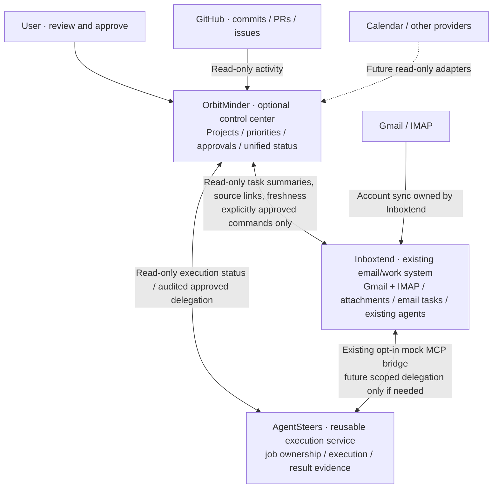

# OrbitMinder architecture — unified monitoring, distributed execution

**Decision recorded:** 2026-11-21. **Status:** target design, not a deployed or end-to-end verified integration.

OrbitMinder is the **optional cross-project control plane**. Inboxtend is the established email-and-task product and remains operational without OrbitMinder. AgentSteers provides an independent, reusable agent execution service for work that is **not already owned/executed by Inboxtend**, or is explicitly delegated to it. Do not route an already-running Inboxtend job into AgentSteers again.

## Target architecture

The solid **arrows describe intended relationships**, not proof that they are all integrated. The only source-implemented Inboxtend ↔ AgentSteers bridge reviewed here is **mock-only**, and is not evidence of real Codex execution. The owner reports using Inboxtend daily, including functional agent execution; the current repository review does not independently verify that particular production path. OrbitMinder does **not** yet consume Inboxtend tasks or AgentSteers status.

## Ownership and non-duplication rules

| Record or capability | System of record | OrbitMinder's role |
| --- | --- | --- |
| Mailbox authorization, full messages, attachments, email drafts | Inboxtend | Link to source; do not independently download/store content as default |
| Email-originated task and its native task status | Inboxtend | Cache a minimal summary and stable external task ID |
| Cross-project grouping, user priorities, reminders and dashboard | OrbitMinder | Own its local project-level metadata only |
| AgentSteers job lifecycle, execution logs and artifact references | AgentSteers | Display evidence-backed, fresh status; never invent completion |
| An existing Inboxtend agent run | Inboxtend / its configured executor | Observe it; do **not** dispatch a second run |
| GitHub code, PRs and issues | GitHub | Read-only project activity summary |

**No double execution:** associate every delegated job with a unique `(source_system, source_task_id, action_kind)` and stable `idempotency_key`. A single authoritative executor owns a dispatch. Before an approved handoff, check for an existing job or indeterminate dispatch, and reconcile rather than retry blindly. Cancellation of an AgentSteers job must not silently close the originating email task.

**No duplicated Gmail integration by default:** OrbitMinder's existing standalone Gmail metadata OAuth/import code is retained as **optional, disabled-by-default standalone capability**, not the integrated Inboxtend path. Do not remove it in this documentation change. Future integrated configurations should obtain minimal read-only task data from Inboxtend through a scoped service API, not copy Gmail credentials.

## Minimal integration contract (proposal; not implemented)

1. **Inboxtend → OrbitMinder, read-only**: authenticated `GET /integration/v1/tasks?updated_since=...` and `GET /integration/v1/tasks/{id}`. Return stable ID, owner scope, title, project, priority, status, due time + timezone, review state, assigned executor, remote job ID (if any), last update, source deep-link, and revision/ETag. Avoid email bodies, attachments and credentials.
2. **OrbitMinder → AgentSteers, read-only**: read per-owner job IDs, queue/running/failed/succeeded/cancelled states, timestamps and evidence URLs. Label mock outcomes distinctly (`queued_mock` is **not** completed).
3. **Approved commands (later)**: scope explicit approval to task revision, destination executor, requested action, affected resources and expiration. Route to Inboxtend if it already owns that task's execution; use AgentSteers only on explicit handoff. Enforce authenticated principal, authorization and idempotency on the receiving server; an OrbitMinder UI click alone is not authorization.
4. **Freshness and recovery**: each source includes `observed_at`, `sync_state`, `source_url`, `external_id`. On outage show stale/unknown; do not erase prior data or infer completion.
5. **Self-hosting**: keep the three products separately deployable. OrbitMinder down must not stop Inboxtend or AgentSteers. Service-to-service tokens remain server-side, least-privilege, rotated and never written to Git/logs.

## Milestones

- **M1 — Inboxtend read-only task feed:** define ownership, scoped API and sample payload; preserve existing production functionality.
- **M2 — OrbitMinder task ingestion + dashboard:** deduplicate by source IDs, display provenance and freshness; no dispatch.
- **M3 — AgentSteers read-only job monitor:** isolate actor identity and distinguish mock from real runs.
- **M4 — Approval-gated delegation:** use one executor per action, idempotent submission and auditable results, verified before enabling real execution.
- **M5 — Additional providers:** Calendar and other project integrations.

Existing OrbitMinder [README](../README.md) and [Gmail adapter notes](gmail-readonly.md) describe **source implementation** and incomplete live setup. This design supersedes the notion that OrbitMinder needs its *own Gmail synchronization* for users already served by Inboxtend. No application code, accounts, mail or deployments were changed by this documentation decision.
